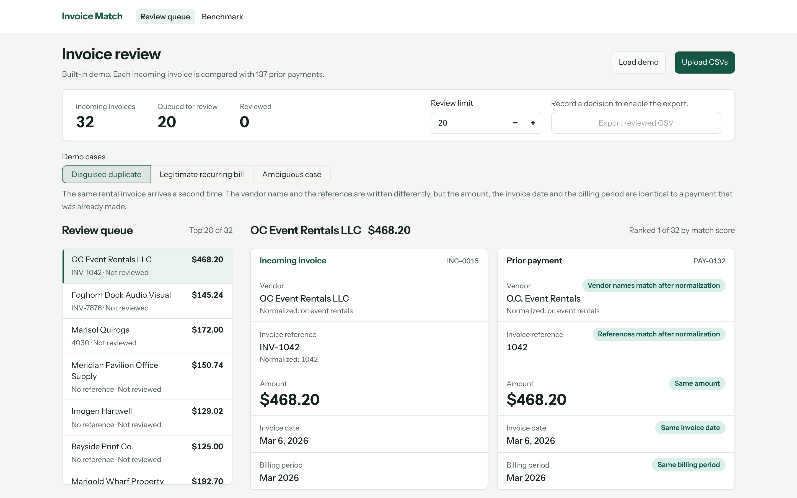
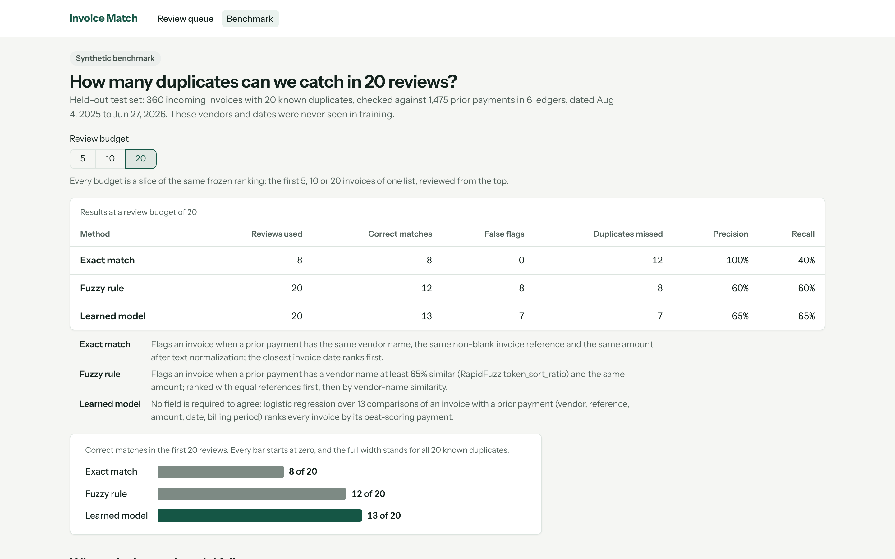

# Invoice Match

**Would you pay this twice?** Invoice Match helps a volunteer treasurer at a small
nonprofit spot possible duplicate invoices before a payment run. A learned model ranks
the incoming invoices by how strongly each one resembles a payment that was already
made. The treasurer reads the evidence side by side and records the decision.

*Veritas AI International High School Hackathon 2026, AI + Finance track.*
**This project is a prototype and is not financial advice.** It runs on synthetic data
with fictional vendors. The model only ranks invoices for review; it never approves,
blocks or pays anything.



## Quick start

Python 3.12 or newer (developed on 3.13).

```bash
python -m venv .venv
source .venv/bin/activate          # Windows: .venv\Scripts\activate
pip install -r requirements.txt
streamlit run app.py
```

Click **Load demo**. The app opens on two $468.20 invoices from "OC Event Rentals LLC"
(INV-1042) and "O.C. Event Rentals" (1042). The **Demo cases** selector jumps to a
legitimate recurring bill and to an ambiguous case. **Upload CSVs** takes your own two
files (schema below). More screenshots: [recurring bill](submission/screenshots/recurring-bill.png),
[ambiguous case](submission/screenshots/ambiguous-case.png),
[a failure](submission/screenshots/benchmark-failure.png), [phone width](submission/screenshots/mobile-review.png). Nothing you upload is saved, logged or sent anywhere; the app
listens on your own computer only.

No install? Open `submission/demo.html` in a browser for a click-through of the same
demo ledger with the model's real scores (uploads need the app).

## Results (measured, synthetic benchmark)

Held-out test set: **360 incoming invoices, 20 known duplicates**, 1,475 prior payments,
6 ledgers, invoice dates 2025-08-04 to 2026-06-27. Its vendor names never appear in
training and its dates come after both earlier splits. Each method proposes one prior payment per incoming invoice and
gets **20 reviews**. The test set was scored once, after every setting was frozen on
validation.

| Method | Reviews used | Correct matches | False flags | Duplicates missed | Precision | Recall |
| --- | ---: | ---: | ---: | ---: | ---: | ---: |
| Exact match | 8 | 8 | 0 | 12 | 100% | 40% |
| Fuzzy rule | 20 | 12 | 8 | 8 | 60% | 60% |
| **Learned model** | 20 | **13** | 7 | 7 | 65% | 65% |



At 10 reviews: 8, 10 and 10 correct. At 5 reviews: 5, 5 and 5. Smaller budgets are
slices of the same frozen rankings.

**How to read it.** The learned model finds 5 more duplicates than exact matching. Its
lead over the tuned fuzzy rule on the test set is a single invoice (13 vs 12), which a
test set with 20 duplicates cannot tell apart from chance. A one-line rule that ignores
the vendor name (same amount; equal references first, then the closest date) also finds
12 of 20. On the three validation folds used for tuning (60 duplicates) the counts were
25 (exact match), 43 (fuzzy rule, and the same one-line rule) and 49 (learned model). So
the model's measurable gain over simple rules is on validation and on the challenge set
below, not on the test set. Accuracy is not reported:
about 1 invoice in 18 is a duplicate, so "flag nothing" would be 94% accurate and useless.

**Challenge set** (40 invoices authored case by case outside the generator, 12 known duplicates, reported separately,
12 reviews): learned model 11, fuzzy rule 9, exact match 4.

**One failure.** A $55.79 invoice from "CATALPA STRAND PRINTING" (INV-8103, 2026-01-21)
re-bills a payment to "Catalpa Strand Printing" (INV-8082, 2026-01-06) for the same
billing period. The model found the right payment but ranked the pair 23rd, just outside
the 20 reviews. Likely cause: a re-sent invoice with a new number looks exactly like the
vendor's next invoice, and the model learned that similar-but-unequal references usually
mean a new bill. All three methods missed every revised-reference duplicate on validation.

**Who gets held for review?** At 20 reviews the learned model flagged 4 of 93 legitimate
invoices from individuals (freelancers, 4.3%) and 3 of 247 from organizations (1.2%).
The counts are small, but the direction matters: sole proprietors often bill the same
fee repeatedly without invoice numbers, so a duplicate checker can delay their pay more
often. The fuzzy rule flagged 2 of 93 and 6 of 247.

Reproduce everything (about 4 minutes):

```bash
pip install -r requirements-dev.txt
python synth.py --splits train validation --demo    # training and validation ledgers, demo ledger
python evaluate.py --stage validate --challenger    # tune on validation, freeze the settings
python synth.py --splits test                       # generate the held-out split only now
python evaluate.py --stage test                     # score the frozen settings once
python -m pytest                                    # about 300 tests
```

The files in `data/` and `results/` are the exact outputs of these commands.
`results/benchmark.json` holds the table above; `results/validation.json` holds every
setting that was tried. Tests check that the train, validation and demo files and the
validation numbers reproduce exactly; rerunning the test stage rewrites an identical
`results/benchmark.json`.

## How it works

```
incoming.csv ─┐                       ┌─ exact match  (baseline)
              ├─ ledger.py ─ pairs ───┼─ fuzzy rule   (baseline)        ─ review queue ─ app.py
payments.csv ─┘   (validate)          └─ logistic regression (learned)     (top 20)
```

1. **Read and validate** (`ledger.py`). Both files share one schema. Money becomes
   integer cents, references stay text, dates must be ISO.
2. **Compare every incoming invoice with every prior payment** (`matcher.py`), 13 features per pair:
   - vendor: cosine similarity of `TfidfVectorizer(analyzer="char_wb", ngram_range=(2, 4))`
     vectors, fitted on training vendor names only, plus RapidFuzz `token_sort_ratio`,
     so vendors the model has never seen still get a signal;
   - invoice reference: RapidFuzz edit similarity (OSA, so two swapped digits count as one
     edit), exact agreement after normalization, and "missing" flags. Leading zeros are
     kept, only a leading word such as INV is dropped, and two blanks never count as a match;
   - amount: exact agreement and log of the difference in cents;
   - invoice date: log of the gap in days;
   - billing period: same, different, or missing on either side.
3. **Rank.** `sklearn.linear_model.LogisticRegression` on standardized features
   (C = 0.03) scores each pair. Each invoice keeps its best-scoring prior payment, and
   invoices are sorted by that score. Ties are broken the same way every time.
4. **Explain.** The sentences on screen ("Same amount", "References match after
   normalization", "Different billing period") come from fixed templates over plain field
   comparisons, never from the model. "Model details" separately shows each feature's
   signed contribution (coefficient × standardized value, in log-odds).
5. **Decide.** The treasurer records *Possible duplicate*, *Legitimate bill* or *Needs
   more information*, can undo, and can export the reviewed queue as CSV.

**Baselines** use the same text normalization, so the methods differ only in logic:
- *Exact match*: same vendor name, same non-blank reference and same amount.
- *Fuzzy rule*: vendor names at least 65% similar and the same amount, ranked with equal
  references first. Its threshold, amount rule and ranking were tuned on validation with
  the same criterion as the model, so it is the best of the 192 variants tried.

**Why logistic regression.** A LightGBM challenger on the same features found 51 of 60
validation duplicates against 49. The rule written down beforehand required a gain of at
least 3, so the simpler model, whose every coefficient can be read, was kept.

### Guarding against leakage

- **Split before pairing, by vendor and by time.** Train (60 ledgers, dates up to
  2024-08-30), validation (18 ledgers, 2024-10-04 to 2025-06-27) and test (6 ledgers,
  2025-08-04 onward) use different vendor words, so a vendor, its aliases and its
  similarly named neighbours never cross a split. One exception we found afterwards: a
  two-letter initials alias, "SP Electric", occurs in both validation and test (nothing is
  fitted on either). The model is trained on earlier dates and tested on later ones.
- **Fit on train only.** The TF-IDF vocabulary, the scaler and the classifier see only
  the 910,860 training pairs (210 positive).
- **Tune on validation only.** Model settings, the fuzzy rule and the LightGBM decision
  were chosen there and written to `results/frozen_config.json` before the test split
  was generated.
- **Formatting cannot reveal the label.** Every record, duplicate or not, goes through
  the same noise (aliases, abbreviations, punctuation, reference prefixes, typos, missing
  fields). A classifier that sees only how a single row is formatted scores a ROC AUC
  between 0.40 and 0.60, i.e. chance; `tests/test_synth.py` asserts this. One realistic
  non-formatting cue remains: a re-sent invoice tends to carry an older date (invoice age
  alone scores ROC AUC 0.74 on the test set). No method uses invoice age, and legitimately
  late invoices are older still.
- **No answer key in the inputs.** Features compare a pair of invoices, plus blank-field
  flags for each side; no IDs. Labels and
  generator metadata live in separate `*_labels.csv` files.

### Evaluation rules

Within each ledger a method proposes one prior payment per incoming invoice. The six
test ledgers' proposals are pooled and sorted by score, and the top 20 are reviewed.
A proposal is *correct* when its prior payment is the one the invoice really repeats
(when an invoice was already paid twice, either payment counts). A legitimate invoice in
the queue, or a duplicate shown with the wrong payment, is a *false flag*. A known
duplicate not shown with a valid payment is *missed*. A method with fewer eligible
proposals uses fewer reviews (exact match used 8).

## CSV schema

Both files use the same columns. Header names are case-insensitive.

| Column | Required | Meaning |
| --- | --- | --- |
| `vendor` | yes | Who sent the bill |
| `amount` | yes | Positive amount, at most two decimals: `468.20`, `$1,234.50` |
| `invoice_date` | yes | `YYYY-MM-DD` only |
| `invoice_ref` | optional | Invoice number as printed; may be blank; leading zeros kept |
| `billing_period` | optional | Month the bill covers, `YYYY-MM`; may be blank |
| `row_id` | optional | Your own unique ID; assigned from file order when absent |

Extra columns are ignored. Limits: 2,000 incoming rows, 20,000 prior payments, 5 MB per
file. Problems are reported by row with a fix, for example *"Row 7: invoice_date
'03/06/2026' is not a valid date. Use YYYY-MM-DD, for example 2026-03-06."* Exports
escape cells that start with `=`, `+`, `-` or `@` so a spreadsheet cannot run them as formulas.
`data/demo/incoming.csv` and `data/demo/payments.csv` are working examples.

## Repository layout

| Path | What it is |
| --- | --- |
| `app.py`, `assets/app.css` | Streamlit app: Review queue and Benchmark pages |
| `ledger.py` | CSV schema, validation, formatting, safe export |
| `matcher.py` | Normalization, pair features, learned model, baselines, evidence text |
| `synth.py` | Deterministic synthetic ledger generator and the demo ledger |
| `evaluate.py` | Benchmark: validation tuning, freeze, test |
| `data/synthetic/` | Train, validation and test ledgers with answer keys |
| `data/demo/` | Curated demo ledger (never used for metrics) |
| `data/challenge/` | Hand-authored challenge ledger |
| `results/` | Frozen settings, validation log, model card, benchmark |
| `tests/` | pytest suite |
| `submission/` | Write-up, video script and a captioned demo video, finals outline, checklist, screenshots, click-through demo |

**Why Streamlit.** One language and one command: the app imports the same `matcher.py`
that the benchmark runs, so what judges see is what was measured, and the team can explain
every file. A React + FastAPI build would have looked sharper but doubled the moving parts.

## Known limitations

- **Synthetic data.** The generator is our own, so the benchmark measures how well the
  methods recover the kinds of duplicates we imagined. It says nothing about accuracy on
  a real ledger, about fraud, or about money saved.
- **Duplicates are over-represented** (about 5.6% of invoices) so that 20 of them fit in
  a small test set. Real duplicate rates are far lower, and precision would be lower too.
- **Small test set.** 20 duplicates: a difference of one or two matches is noise.
- **Blind spot.** A re-sent invoice with a new number looks like the next invoice.
- **Matches against prior payments only.** Two copies inside the same incoming batch are
  not compared with each other.
- **English-style names, one currency, ISO dates, monthly billing periods.**
- **The match score is a ranking score, not a probability.**

## Credits

- **Data:** all ledgers are synthetic, generated by `synth.py` or authored case by case
  (the challenge set, also with AI assistance) for this project. No external dataset, no real invoices, no personal information.
- **Libraries:** [pandas](https://pandas.pydata.org/), [NumPy](https://numpy.org/),
  [scikit-learn](https://scikit-learn.org/) (`LogisticRegression`, `TfidfVectorizer`,
  `StandardScaler`), [RapidFuzz](https://github.com/rapidfuzz/RapidFuzz),
  [Streamlit](https://streamlit.io/), [LightGBM](https://lightgbm.readthedocs.io/)
  (challenger only), [pytest](https://pytest.org/), [Playwright](https://playwright.dev/)
  (browser checks and screenshots).
- **Font:** [Instrument Sans](https://github.com/Instrument/instrument-sans), SIL Open
  Font License 1.1 (`static/fonts/OFL-InstrumentSans.txt`).
- **References:** the event's Project Briefs (rules, track requirements, write-up
  template); [OWASP: CSV Injection](https://owasp.org/www-community/attacks/CSV_Injection)
  for the export escaping. No tutorial code and no pretrained model were used.
- **AI assistance:** [Claude](https://claude.ai/) (Anthropic), through Claude Code, was
  wrote and tested the code, generated the synthetic data and the challenge set, and
  drafted the documents, working from the team's project specification and review. No AI model or API runs inside the app.

All vendor names are invented; any resemblance to a real business is coincidental.
